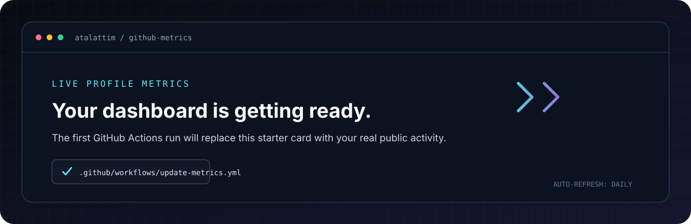

<!--
  Profile: https://github.com/atalattim
  Replace the files in your existing `atalattim/atalattim` repository with this pack.
  The metrics SVG is refreshed by .github/workflows/update-metrics.yml.
-->

<div align="center">
  

  <br />

  <a href="https://github.com/atalattim">
    
  </a>
  <a href="https://marutiatalatti.netlify.app/">
    
  </a>
  <a href="https://github.com/atalattim?tab=repositories">
    
  </a>

  <br /><br />

  
</div>

---

## `01 / PROFILE` — Curious by default. Practical by choice.

Hey, I'm **Maruti Ranganatha Atalatti** — a **B.Tech Computer Science and Engineering student** focused on strengthening fundamentals and building practical software projects.

I use this profile to document what I'm learning, share projects, and keep improving through practice. I'm working toward becoming internship-ready through better problem-solving, clear project documentation, and consistent development habits.

<table>
  <tr>
    <td width="50%" valign="top">
      <strong>NOW</strong><br />
      Learning C and Python fundamentals, exploring frontend development, and practicing Git/GitHub.
    </td>
    <td width="50%" valign="top">
      <strong>NEXT</strong><br />
      Build complete projects, improve data-structures/problem-solving skills, and prepare for internships and placements.
    </td>
  </tr>
</table>

## `02 / TOOLKIT` — Current learning stack

<div align="center">
  
</div>

<p align="center"><sub>Icons represent my learning toolkit, not a claim of expert-level proficiency.</sub></p>

| Area | Current focus |
|:--|:--|
| **Programming** | C, Python |
| **Web fundamentals** | HTML, CSS, JavaScript |
| **Developer workflow** | Git, GitHub, Visual Studio Code |
| **Professional goal** | Project-based learning and internship preparation |

## `03 / SELECTED WORK` — Built, explored, improving

<table>
  <tr>
    <td width="50%" valign="top">
      <h3>◈ PlacePrepAI</h3>
      <p>A placement-preparation platform project. Explore the source repository for its current architecture, setup instructions, and implementation details.</p>
      <a href="https://github.com/atalattim/placeprep">
        
      </a>
    </td>
    <td width="50%" valign="top">
      <h3>◈ Personal Portfolio</h3>
      <p>A personal website and web-development work showcase. Visit the live site or browse its source repository.</p>
      <a href="https://marutiatalatti.netlify.app/">
        
      </a>
      <br /><br />
      <a href="https://github.com/atalattim/portfolio_website_maruti_atalatti">
        
      </a>
    </td>
  </tr>
</table>

## `04 / GITHUB SIGNAL` — Real activity, automatically refreshed

<div align="center">
  
</div>

<sub>The metrics graphic is generated from public GitHub data by the included workflow. On first setup, the starter graphic above remains until the first successful run; afterward it refreshes daily. GitHub language statistics reflect repository contents, not proficiency.</sub>

## `05 / LEARNING LOOP`

```text
READ  →  BUILD  →  TEST  →  DEBUG  →  DOCUMENT  →  REPEAT
```

- Strengthen programming fundamentals and problem-solving.
- Build small, complete projects instead of collecting unfinished tutorials.
- Write useful READMEs so projects are easier to run and review.
- Keep improving my portfolio for internship and placement opportunities.

## `06 / CONNECT`

<div align="center">
  <a href="https://github.com/atalattim"></a>
  <a href="https://marutiatalatti.netlify.app/"></a>
</div>

<div align="center">
  <br />
  <sub><strong>STAY CURIOUS · SHIP SMALL · IMPROVE OFTEN</strong></sub>
  <br /><br />
  
</div>
